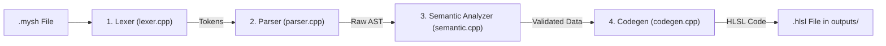

# mysh - HLSL Compiler Pipeline

A beginner-friendly Domain-Specific Language (DSL) compiler that converts `.mysh` shader files into standard, error-free **HLSL (High-Level Shader Language)** shaders.

Created for College Third Year (TY) **Compiler Design (CD)**.

---

## 📁 Project Structure

The project is organized into clear, separate folders:

```text
CD Compiler/
├── compiler/              <-- All Compiler Phase Source Files (No .h files!)
│   ├── lexer.cpp          <-- Phase 1: Lexical Analysis
│   ├── parser.cpp         <-- Phase 2: Syntax Analysis
│   ├── semantic.cpp       <-- Phase 3: Semantic Analysis
│   ├── codegen.cpp        <-- Phase 4: Code Generation
│   └── main.cpp           <-- Driver Program (orchestrates 1 -> 2 -> 3 -> 4)
│
├── inputs/                <-- .mysh Input Files
│   ├── Fire.mysh
│   ├── Water.mysh
│   ├── Plasma.mysh
│   ├── Acid.mysh
│   └── Hologram.mysh
│
├── outputs/               <-- Generated .hlsl Files
│   ├── Fire.hlsl
│   ├── Water.hlsl
│   ├── Plasma.hlsl
│   ├── Acid.hlsl
│   └── Hologram.hlsl
│
├── mysh.cmd               <-- Command wrapper for terminal
├── mysh.exe               <-- Compiled compiler binary
└── README.md
```

---

## 🔄 Sequential 4-Phase Flow

In [`compiler/main.cpp`](file:///c:/Users/khand/Documents/College/TY/CD%20Compiler/compiler/main.cpp), each compiler phase is called one by one:



1. **Phase 1: Lexical Analysis ([`compiler/lexer.cpp`](file:///c:/Users/khand/Documents/College/TY/CD%20Compiler/compiler/lexer.cpp))**
   - Reads characters from the file.
   - Converts source text into a stream of typed tokens (`TOKEN_SHADER`, `TOKEN_COLOR`, `TOKEN_NUMBER`, etc.).
   - Strips whitespace and comments while preserving line tracking.

2. **Phase 2: Syntax Analysis ([`compiler/parser.cpp`](file:///c:/Users/khand/Documents/College/TY/CD%20Compiler/compiler/parser.cpp))**
   - Validates that tokens follow the grammar rules of the `.mysh` language.
   - Builds a clean Abstract Syntax Tree (`RawShaderAST`).

3. **Phase 3: Semantic Analysis ([`compiler/semantic.cpp`](file:///c:/Users/khand/Documents/College/TY/CD%20Compiler/compiler/semantic.cpp))**
   - Validates identifier symbols and resolves color names (`orange`, `blue`, `purple`, etc.) into normalized RGBA floats.
   - Checks value domains (e.g., ensuring `scale > 0`, checking sensible `distortion` and `emission` ranges).
   - Generates a verified `ValidatedShaderData` structure.

4. **Phase 4: Code Generation ([`compiler/codegen.cpp`](file:///c:/Users/khand/Documents/College/TY/CD%20Compiler/compiler/codegen.cpp))**
   - Emits syntactically valid and error-free HLSL shader code.
   - Includes standard HLSL `cbuffer`, vertex input/output structures, procedural 2D noise algorithms, and vertex/pixel shaders.

---

## 🛠️ How to Build & Run

### 1. Compile the Compiler
From the project root:
```powershell
g++ compiler/main.cpp -o mysh.exe
```

### 2. Run on any `.mysh` file
```powershell
.\mysh.exe inputs/Fire.mysh
.\mysh.exe inputs/Water.mysh
.\mysh.exe inputs/Plasma.mysh
.\mysh.exe inputs/Acid.mysh
.\mysh.exe inputs/Hologram.mysh
```
*(Or use `mysh inputs/Fire.mysh` directly)*

Output files are automatically generated into the [`outputs/`](file:///c:/Users/khand/Documents/College/TY/CD%20Compiler/outputs) directory!
